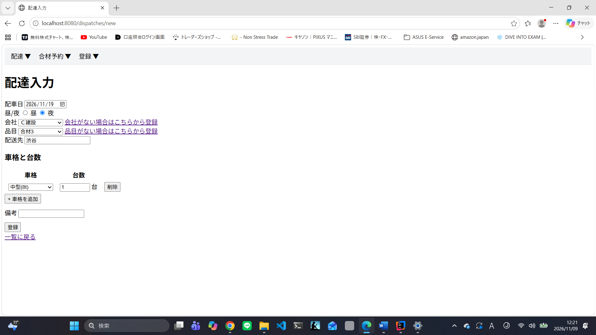
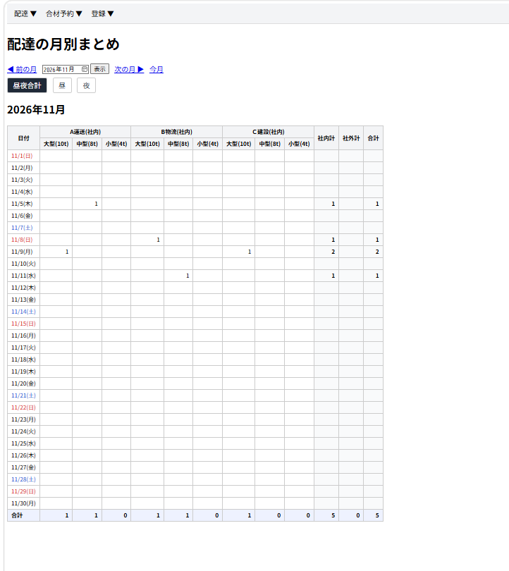
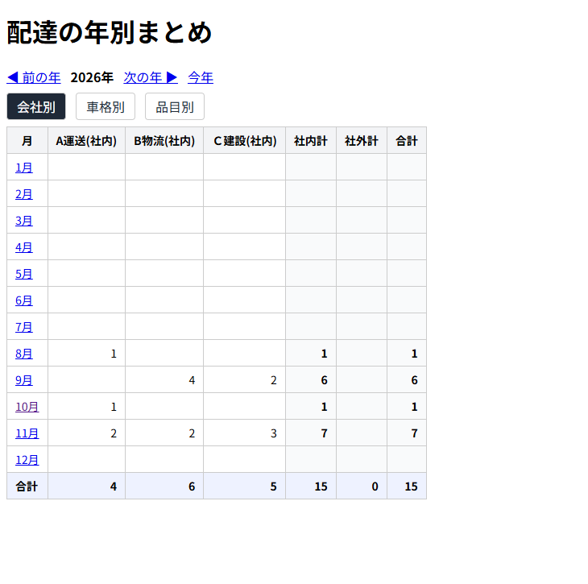

# 配車管理アプリ

Excelで管理していた配達・合材予約の表を、Webで入力・集計できるようにした業務アプリです。

- **配達**:工場からお客さんへ合材を届けた記録
- **合材予約**:お客さんが工場に合材を取りに来る予約

## 作った理由

現在の職場では、以前は合材の予約などをExcelに入力して管理していました。社内システムのアップデートで、これらの情報がシステムに取り込まれるようになりましたが、予約などは1週間分の表しか表示されず、月ごとや年ごとの状況を確認するのが難しくなりました。
そこで、1件ずつ入力すれば、一覧に加えて月別・年別の集計が自動でできる仕組みを作りたいと考え、このアプリを作りました。
## 画面

### 配達入力
車格と台数を何行でもまとめて入力できます。



### 月別まとめ
1週間分しか見られなかった情報を、月単位で自動集計して確認できます。



### 年別まとめ
月ごとの台数を、お客さん別・車格別・品目別に切り替えて確認できます。


## 主な機能

**配達**
- 配達の入力(お客さん・品目・配送先、車格と台数を複数行でまとめて入力)
- 配達一覧(日付の切り替え、車格ごとの合計)
- 月別まとめ・年別まとめ(自動集計)
- 編集・削除

**合材予約**
- 予約の入力(品目と数量を複数行で入力、0.1t単位)
- 予約一覧(日付の切り替え、引取済み・キャンセル、品目ごとの合計トン数)
- 月別まとめ・年別まとめ(引取済みの数量を自動集計)
- 編集・削除

**共通**
- お客さん・品目の登録(重複チェックつき)
- 入力チェック、登録ボタンの二重押し防止
- 曜日つきの日付表示(土曜は青、日曜は赤)
- 日本語のエラー画面

## 使用技術

| 分類 | 技術 |
|---|---|
| 言語 | Java 17 |
| フレームワーク | Spring Boot、Spring Data JPA、Bean Validation |
| 画面 | Thymeleaf、HTML、CSS、JavaScript |
| データベース | H2 Database |
| ビルド・管理 | Maven、Git、GitHub |
| 開発環境 | IntelliJ IDEA |

## 工夫したところ

- 実際の業務のExcelをもとに、1回の入力で車格ごとの台数をまとめて入れられるようにした
- 使う人が迷わないように、プルダウンでの選択、重複チェック、登録完了のメッセージを入れた
- 月別・年別のまとめは、`GROUP BY`と`SUM`を使ったSQL(JPQL)で集計している
- テーブル設計:配達とお客さん・品目は多対1、予約と品目の行は1対多

## 開発について

生成AIを活用しながら開発し、コードは1行ずつ読み解いて理解するようにしました。

## 起動方法

Java 17 以上が必要です。

```bash
# Windows
mvnw.cmd spring-boot:run
```

起動後、ブラウザで http://localhost:8080 を開いてください。

## 今後の予定

- 配車(運送会社からのダンプ手配)を別の機能として追加
- 運送会社との保証台数の比較、目標ペースの表示
- 画面の見た目の改善